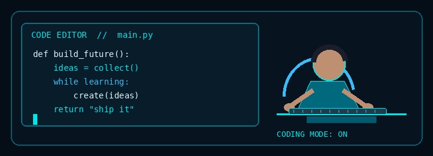
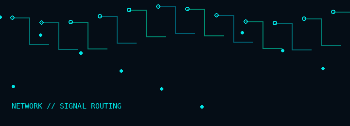
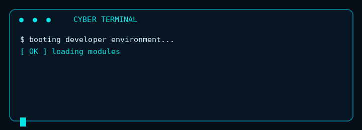
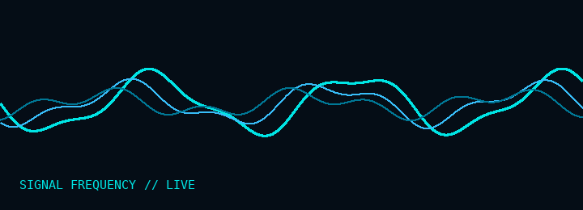

---

## `01` ABOUT ME

- 🌱 Exploring, learning, and building with code.
- 💡 I enjoy turning ideas into useful, creative projects.
- 🎯 Always improving my problem-solving skills.
- ⚡ Interested in fullstack development, game development, and ai.

## `02` DEVELOPER AT WORK

## `03` TECH STACK

  

## `04` SYSTEM NETWORK

## `05` LIVE TERMINAL

## `06` SIGNAL FREQUENCY

## `07` // CONTRIBUTION SNAKE

  

## `08` CONTRIBUTION ACTIVITY

## `09` GITHUB ANALYTICS

## `10` CONNECT

<!-- Add your LinkedIn, email, or other social links here when you want to share them. -->

**Thanks for visiting. Keep creating. Keep shipping.**

